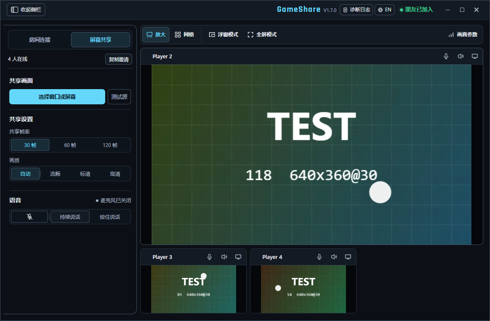

# GameShare

[简体中文](README.md)

**Play your own game while watching your friends play theirs.**

GameShare is a Windows screen-sharing app for groups of friends. Everyone in a room can share a game window, watch each other's screens, and join voice chat. The current desktop client uses Tauri 2 and WebView2, with WebRTC for audio and video.



*The Tauri client in focus layout, using built-in test sources.*

## Features

- **Share and watch at the same time.** A room holds up to eight people. With WebRTC Mesh, each additional viewer increases upload and encoding load.
- **Keep friends' screens in view.** Switch between focus, grid, borderless fullscreen, and independent always-on-top windows. Adjust each person's voice and shared audio separately.
- **Share game sound and talk.** GameShare tries to capture the selected window's app audio. You can also choose an audio app manually or mute shared audio. Voice chat has continuous and push-to-talk modes.
- **Choose how to connect.** Use Direct IP on a shared LAN, or a temporary Cloudflare invite URL or public forwarding address across networks. Audio and video negotiate a separate connection.

## Get GameShare

GameShare targets Windows 10 / 11 x64 and requires the WebView2 Evergreen Runtime. Windows 11 is recommended for sharing app audio.

Under **Assets** on the release page, download the Windows x64 portable ZIP ending in `-portable-cloudflare.zip`. [Download GameShare](https://github.com/Rinko-LH/GameShare/releases)

Extract the full ZIP, then run the EXE whose name starts with `GameShare-Tauri`. Keep the bundled `cloudflared.exe` next to the app to use temporary Cloudflare invite links.

## Quick start

1. **Host a room.** In the room setup, choose **Create room**. On the same LAN, choose **Direct IP** and select an address your friends can reach. Across networks, you can choose **Cloudflare** and wait for the temporary invite link. Start with **Automatic** for the video and audio channel.
2. **Join the room.** The host clicks **Copy invite** and sends it privately. Guests choose **Join room**, paste the full invite, and click **Join room**.
3. **Share a screen.** Under **Screen sharing**, click **Choose window or screen**. Turn on the microphone separately if you want to talk. Use **Test source** to send a silent test picture.

The Cloudflare option requires a compatible `cloudflared.exe` and forwards room signaling. If you can join a room but can't see a shared screen, check the audio/video path. Send invites only to people you trust. When you finish, close the temporary link or quit GameShare. [Connection options (Chinese)](docs/CONNECTION-OPTIONS.md) · [Remote troubleshooting (Chinese)](docs/REMOTE-TESTING.md)

## Run from source

Install Node.js 22.12 or newer, the Rust MSVC toolchain, Visual Studio C++ Build Tools, and the Windows SDK. Run the following commands from the repository root.

```powershell
npm ci --cache .cache/npm
npm run dev:desktop
```

`npm run build:desktop` compiles a test executable. See the [build guide (Chinese)](docs/BUILD-NOTES.md) for build output, the Cloudflare component, and running multiple clients.

## Documentation

| Topic | Guide |
| --- | --- |
| Screen sharing, game sound, voice, and floating windows | [User guide](docs/SHARING.md) |
| Connection options and troubleshooting | [Connection options](docs/CONNECTION-OPTIONS.md) · [Remote testing](docs/REMOTE-TESTING.md) |
| Source layout, tests, and contributions | [Architecture](docs/ARCHITECTURE.md) · [Contributing](CONTRIBUTING.md) |
| Project status and full documentation index | [Project status](docs/ROADMAP.md) · [Documentation index](docs/README.md) |

The guides above are in Chinese.

## Upstream and license

GameShare is a fork of [lxg65432-ship-it/gameshare](https://github.com/lxg65432-ship-it/gameshare). The original Electron project's Chinese and English READMEs, developer docs, and screenshots are available in the [upstream archive](docs/archive/README.md). GameShare is licensed under the [MIT License](LICENSE) and retains the original copyright notice for 李小刚.
