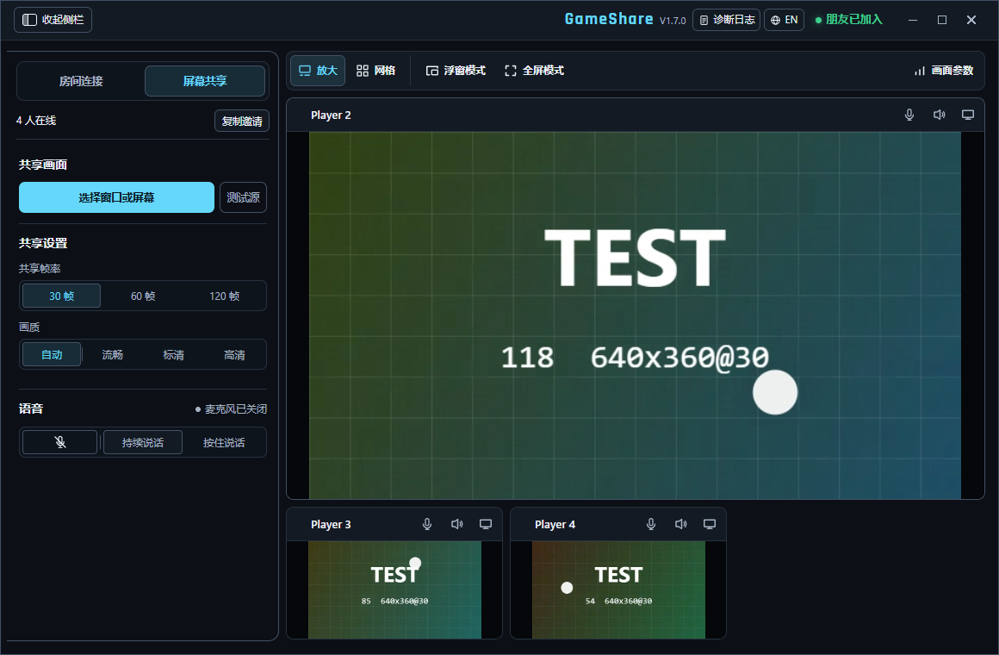

# GameShare

[English](README.en.md)

**各玩各的游戏，也能在同一个房间里看见彼此的画面。**

GameShare 是面向熟人小队的 Windows 画面共享工具。每个人都可以共享自己的游戏窗口、观看队友的画面并加入语音。当前客户端基于 Tauri 2 和 WebView2，音视频通过 WebRTC 传输。



*Tauri 客户端的放大布局，使用内置测试源。*

## 能做什么

- **多人互看**　房间最多 8 人，每个人都能同时分享和观看。WebRTC Mesh 的上行带宽和编码负担会随观看人数增加。
- **边玩边看**　在放大、网格、无边框全屏和独立置顶浮窗之间切换。每位队友的麦克风语音和共享声音都可以单独调节。
- **分享游戏声音**　共享窗口时会尝试接入对应应用的声音。也能手动选择音频应用，或关闭共享声音。麦克风支持持续说话和按住说话。
- **按网络选连接方式**　同一局域网可用 IP 直连。异地可用 Cloudflare 临时邀请网址或已有的公网映射。音视频链路独立协商。

## 获取 GameShare

面向 Windows 10 / 11 x64，需要 WebView2 Evergreen Runtime。使用应用声音共享时推荐 Windows 11。

在发布页的 **Assets** 中下载 Windows x64 便携 ZIP，文件名以 `-portable-cloudflare.zip` 结尾。 [下载 GameShare](https://github.com/Rinko-LH/GameShare/releases)

完整解压后，双击 `GameShare-Tauri` 开头的 EXE。将随包的 `cloudflared.exe` 保留在主程序同一目录，即可使用 Cloudflare 临时邀请网址。

## 快速开始

1. **房主创建房间。** 在「房间连接」里选择「创建房间」。同一局域网选择「IP直连」并选择队友可访问的地址。异地可以选择「Cloudflare」，等待临时邀请网址就绪。两种场景都可以先用「自动协商」传输音视频。
2. **队友加入房间。** 房主点击「复制邀请」并私发给队友。队友选择「加入房间」，粘贴完整邀请，再点击「加入房间」。
3. **选择要共享的画面。** 在「屏幕共享」点击「选择窗口或屏幕」。语音可独立开启。用「测试源」可以先发一段静音测试画面。

Cloudflare 自动隧道需要可用的 `cloudflared.exe`，负责转发进房所需的信令。若能进房却收不到画面，按音视频链路排查。邀请包含房间入口和房间码，请只发给信任的人。临时网址用完可关闭，或直接退出 GameShare。 [连接选择](docs/CONNECTION-OPTIONS.md) · [跨网排查](docs/REMOTE-TESTING.md)

## 从源码运行

准备 Node.js 22.12 或更新版本、Rust MSVC 工具链、Visual Studio C++ 生成工具和 Windows SDK。在仓库根目录执行以下命令。

```powershell
npm ci --cache .cache/npm
npm run dev:desktop
```

`npm run build:desktop` 可编译测试 EXE。Cloudflare 组件、构建产物位置和本地多开流程见 [构建与开发](docs/BUILD-NOTES.md)。

## 文档

| 主题 | 入口 |
| --- | --- |
| 共享画面、游戏声音、语音与浮窗 | [使用指南](docs/SHARING.md) |
| 连线方式、自备公网入口与故障排查 | [连接选择](docs/CONNECTION-OPTIONS.md) · [跨网测试](docs/REMOTE-TESTING.md) |
| 源码结构、测试与贡献 | [架构](docs/ARCHITECTURE.md) · [贡献指南](CONTRIBUTING.md) |
| 当前版本和完整文档目录 | [项目现状](docs/ROADMAP.md) · [文档索引](docs/README.md) |

## 上游与许可

GameShare fork 自 [lxg65432-ship-it/gameshare](https://github.com/lxg65432-ship-it/gameshare)。原项目采用 Electron，原始中英文 README、开发文档和截图可在 [上游档案](docs/archive/README.md) 查阅。项目采用 [MIT 许可证](LICENSE)，保留原作者李小刚的版权声明。
