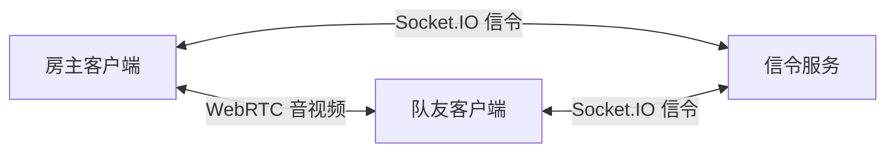

# GameShare 架构

GameShare 的主客户端是 Windows 上的 Tauri 2 应用。WebView2 中的 React 界面协调房间与采集，WebRTC 为房间中每对成员建立媒体链路。Tauri 内置 Rust 信令服务，也可以连接单独部署的 Node.js 信令服务。

Cloudflare 临时网址转发房间信令。媒体通过 ICE 尝试直连，配置了 TURN 且选中中继候选时，媒体才经 TURN 转发。每位发送者与其他成员分别维持媒体链路，分辨率、帧率和每路码率都会影响总上行与编码开销。内置信令的房间上限为 8 人，实机可用规模取决于成员同时发送的路数、网络和设备性能。连接组合和排查步骤见[连接选项](CONNECTION-OPTIONS.md)与[跨网络测试](REMOTE-TESTING.md)。

## 源码入口

| 目录或模块 | 职责 |
| --- | --- |
| [apps/tauri/src-tauri](../apps/tauri/src-tauri/Cargo.toml) | Tauri 窗口与权限、Rust 内置信令、临时隧道、Windows 全局按住说话与应用音频。 |
| [apps/desktop/src](../apps/desktop/src/App.tsx) | React 界面、连接设置、共享和语音。Tauri 和 Electron 复用此处的会话与界面代码。 |
| [ShareSession](../apps/desktop/src/session/ShareSession.ts)、[PeerLink](../apps/desktop/src/rtc/PeerLink.ts) | 管理房间成员、采集轨道、媒体状态和逐成员 WebRTC 协商。 |
| [apps/signaling](../apps/signaling/src/index.ts) | 可独立部署的 Socket.IO 信令服务。Electron 通过 [embed.ts](../apps/signaling/src/embed.ts) 嵌入同一套 TypeScript 实现。 |
| [packages/protocol](../packages/protocol/src/index.ts)、[packages/shared](../packages/shared/src/index.ts) | 房间与媒体协议、画质规则、共享工具。协议变更涉及 TypeScript 和 Rust 信令两端。 |
| [apps/tauri-preview](../apps/tauri-preview/README.md) | 独立的 WebView2 浮窗实验。 |

## 房间和信令

客户端用 Socket.IO 确认回包创建、加入及离开房间。加入时同步已有成员和各自的共享状态，后续通过事件跟踪成员和共享变化。信令服务在同房间内转发 SDP、ICE 候选和画质请求，发送者身份由服务端根据连接补充。客户端根据成员列表关闭已离开的链路，并过滤它的迟到回调。

Rust [内置信令](../apps/tauri/src-tauri/src/signaling.rs)默认监听 `8080`，提供房间操作、`/health` 和 WebRTC 信令转发。Tauri 可以消费兼容信令在建房或入房时返回的 TURN 凭据。仓库内的签发逻辑位于 [Node.js 信令工厂](../apps/signaling/src/signaling-server.ts)，目前由配置了凭据的 Electron 内置信令启用。Tauri 内置和 Node.js 独立启动入口均保持此功能关闭。

## 媒体链路

两端按成员 ID 确定初始协商的主动方。它按 `video`、`voice`、`appAudio` 的固定顺序建立三个 transceiver，接收方用协商后的 MID 识别轨道角色，详见 [media-roles.ts](../packages/protocol/src/media-roles.ts)。开关共享使用 `replaceTrack` 更新视频与共享声音，麦克风继续走独立的语音轨道。观看者暂停某位成员的共享时，重新协商已有共享轨的接收方向，保留语音和本机发出的媒体。

发送端配置分辨率、帧率和每路视频的码率上限。缩放依据采集源实际尺寸，最终画质还受网络与性能限制。Tauri 放大布局会向缩略图对应的发送端发出按观看者生效的降档请求，切回大画面或网格后恢复默认策略。接收和发送诊断从 WebRTC 统计读取实际值，码率以 RTP 字节差与报告时间戳计算。

## Windows 采集和浮窗

窗口和屏幕视频由 [CaptureManager](../apps/desktop/src/media/CaptureManager.ts) 发起 WebView2 的共享选择面板。应用音频通过 [Windows 进程回环](../apps/tauri/src-tauri/src/process_audio.cpp)捕获，采集失败时可保留视频并手动指定音频应用。麦克风由 [MicCapture](../apps/desktop/src/media/MicCapture.ts) 管理。按住说话切换语音轨的发送启用状态，原生热键实现位于 [voice.rs](../apps/tauri/src-tauri/src/voice.rs)。

[独立浮窗](../apps/desktop/src/tauri-tiles.ts)通过本机的 WebRTC 连接接收主 WebView 转发的视频。Tauri 窗口事件交换本机 SDP 和窗口控制信息，语音和共享声音由主窗口统一播放。这样切换布局或关闭浮窗时，可以沿用主窗口中的播放和音量状态。

更早的 Electron 实现细节与取证记录见[上游架构文档](archive/upstream-electron/docs/ARCHITECTURE.md)。
